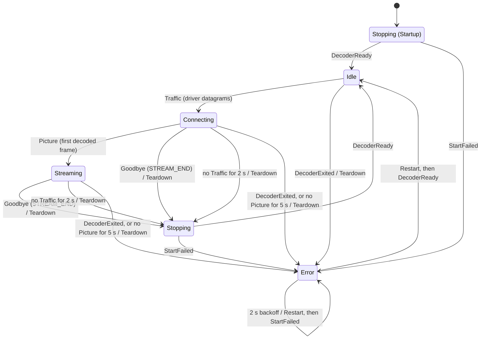

# Bridge preview lifecycle

The bridge's embedded preview (driver → `127.0.0.1:42069` → ffmpeg → hub viewer)
runs this state machine. It covers the Bridge preview only; the phone stream is
not involved.

- Logic: `bridge/crates/cardboard-bridge/src/preview_lifecycle.rs` (pure, unit-tested)
- Supervisor: `AppCore::preview_supervisor` in `src/core.rs`
- Receive/decode plumbing: `src/net/preview.rs`
- Current state: `preview_state` in `GET /status`, `state` in `GET /preview`

| State | Meaning | Viewer |
|---|---|---|
| Idle | Decoder running, no stream | idle screen (`icons/stream.svg` on black) |
| Connecting | Driver datagrams arriving, waiting for a decodable keyframe | idle screen |
| Streaming | Decoded pictures shown | live video |
| Stopping | Stream ended (Startup / Goodbye / Timeout); decoder being replaced | idle screen |
| Error | Decoder exited, stalled, or could not start; port unavailable | idle screen, retried every 2 s |

## Events

Every transition is triggered by an observed event, never by a guess:

| Event | Source |
|---|---|
| Traffic | Receive thread counted a valid CBPV frame fragment |
| Picture | ffmpeg of the current generation produced a picture |
| Goodbye | `STREAM_END` control datagram (driver unload, preview off) |
| DecoderExited | ffmpeg stdout closed for the current generation |
| Tick (50 ms) | Timeouts: `STREAM_TIMEOUT` 2 s without Traffic, `DECODE_TIMEOUT` 5 s without Picture, `RETRY_BACKOFF` 2 s |
| DecoderReady / StartFailed | Result of starting ffmpeg |

A driver or SteamVR that dies sends no goodbye; its stream ends through the 2 s
timeout. A clean shutdown sends `STREAM_END` and the viewer clears at once.

## Teardown (every edge into Stopping or Error)

1. The receive thread stops feeding the decoder (generation set to 0). The old
   queue handle is dropped, so the writer thread exits.
2. The frame slot is cleared under its lock and stops accepting pictures from
   the old generation, so a picture still in flight cannot reappear.
3. ffmpeg is killed and reaped. This is the decoder flush: its reference frames
   and internal queue are gone.
4. The hub poller sees the clear flag and sets the viewer back to the idle
   image. The last RGBA buffer and the Slint image are released.
5. For Stopping, a new ffmpeg starts right away (generation + 1) and the state
   goes to Idle. For Error, the restart waits for the backoff.

The receive thread and UDP 42069 stay up the whole time. The next stream goes
Idle → Connecting with no app restart. A new decoder always starts at a keyframe
with SPS, because the gate resyncs on each generation change and requests an IDR.
